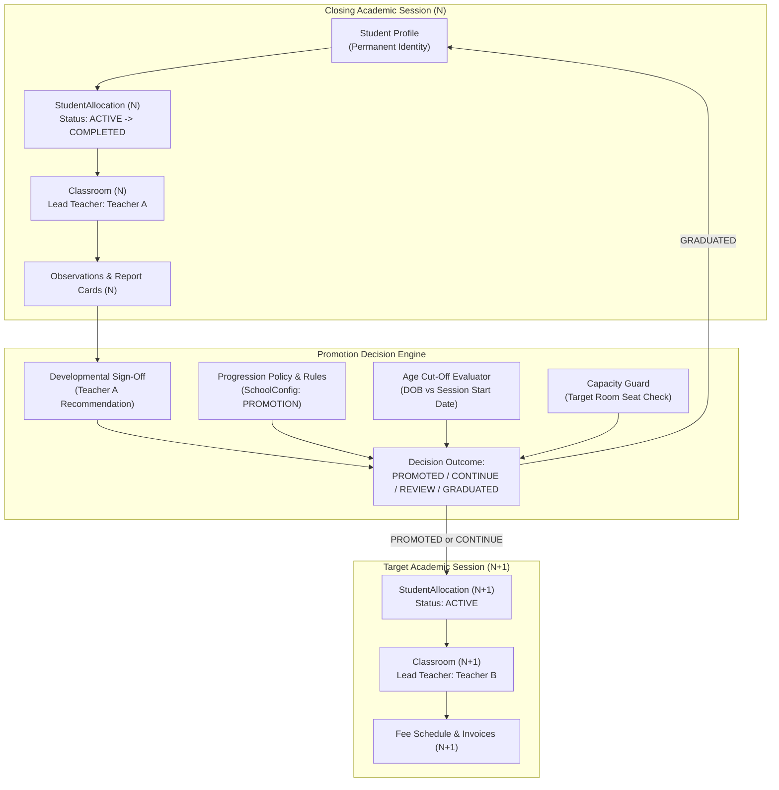

# PreOne Promotion Engine Architecture
**Specification:** `PRE1-STUDENT-LIFECYCLE-001`  
**Domain:** System Architecture & Data Model  
**Version:** 1.0.0  

---

## 1. Domain Architecture Overview

The PreOne Promotion Engine orchestrates multi-session academic progression while enforcing multi-tenant isolation, branch scoping, and immutable historical records.



---

## 2. Entity Model & Relationship Mapping

### 2.1 Core Entities Reused
- **`Student` (`students`):**
  - Continuous identity holding `id`, `admissionNo`, `dob`, `gender`, `status`.
  - Pointer: `currentClassroomId` points to active section in the live academic session.
- **`StudentAllocation` (`student_allocations`):**
  - Historical allocation ledger.
  - Fields: `id`, `tenantId`, `studentId`, `academicSessionId`, `classroomId`, `programType`, `status` (`ACTIVE`, `COMPLETED`, `PROMOTED`, `TRANSFERRED`, `WITHDRAWN`), `startedAt`, `endedAt`, `reason`.
- **`AcademicSession` (`academic_sessions`):**
  - Session lifecycle: `PLANNED` $\rightarrow$ `ACTIVE` $\rightarrow$ `CLOSING` $\rightarrow$ `CLOSED` $\rightarrow$ `ARCHIVED`.
- **`Classroom` (`classrooms`):**
  - Section entity tied to an `academicSessionId` and `branchId` with capacity and teacher allocation.
- **`Program` (`programs`):**
  - Master program definitions with minimum/maximum age thresholds and default progression ladders.
- **`SchoolConfig` (`school_configs`):**
  - Stores domain `PROMOTION` containing institutional progression policy, age cut-off dates, approval requirements, and capacity strategies.

---

## 3. Atomic State Transitions & Transaction Boundaries

### 3.1 Student Promotion Execution (Step-by-Step Transaction)
When promotion is approved for student $S$ moving from Classroom $C_1$ (Session $Y_1$) to Classroom $C_2$ (Session $Y_2$):

```
BEGIN TRANSACTION:
  1. Lock Classroom C_2 FOR UPDATE.
  2. Verify active seat count in C_2 < C_2.capacity (if STRICT_REJECT).
  3. Update existing StudentAllocation for S where academicSessionId = Y_1:
       SET status = 'COMPLETED', endedAt = NOW(), reason = 'Promoted to Y_2'
  4. Create new StudentAllocation:
       INSERT (tenantId, studentId = S.id, academicSessionId = Y_2, classroomId = C_2.id,
               programType = C_2.programType, status = 'ACTIVE', startedAt = NOW(),
               createdById = actorId, createdByName = actorName)
  5. Update Student:
       SET currentClassroomId = C_2.id, status = 'ACTIVE'
  6. Insert TimelineEntry:
       type = 'MILESTONE', title = 'Promoted to Y_2', body = 'Promoted to C_2.name'
  7. Insert AuditLog:
       action = 'PROMOTE_STUDENT', entity = 'Student', entityId = S.id
COMMIT TRANSACTION
```

### 3.2 Student Graduation Execution
When student $S$ graduates from terminal class (e.g. Sr. KG / UKG):

```
BEGIN TRANSACTION:
  1. Update existing StudentAllocation for S in Y_1:
       SET status = 'COMPLETED', endedAt = NOW(), reason = 'Graduated preschool program'
  2. Update Student:
       SET status = 'GRADUATED', currentClassroomId = NULL
  3. Insert TimelineEntry:
       type = 'MILESTONE', title = 'Graduated', body = 'Completed Sr. KG curriculum'
  4. Insert AuditLog:
       action = 'GRADUATE_STUDENT', entity = 'Student', entityId = S.id
COMMIT TRANSACTION
```

---

## 4. Academic-Year Isolation & Historical Integrity

1. **No Data Overwriting:**
   Historical attendance records, daily care notes, incident logs, observations, and term report cards remain permanently attached to the historical `academicSessionId` and `classroomId`.
2. **Teacher Access Partitioning:**
   - **Old Teacher:** Loses operational write privileges (daily diary, check-in, real-time logs) once session $Y_1$ closes, but retains read-only review rights to portfolio items generated during their tenure.
   - **New Teacher:** Gains operational write access to Classroom $C_2$ upon assignment and session activation.
3. **Parent Portal Experience:**
   - Parent accounts remain continuous.
   - The primary dashboard displays active student status tied to `Student.currentClassroom`.
   - Multi-year switcher enables access to past session report cards and photos without data mingling.
