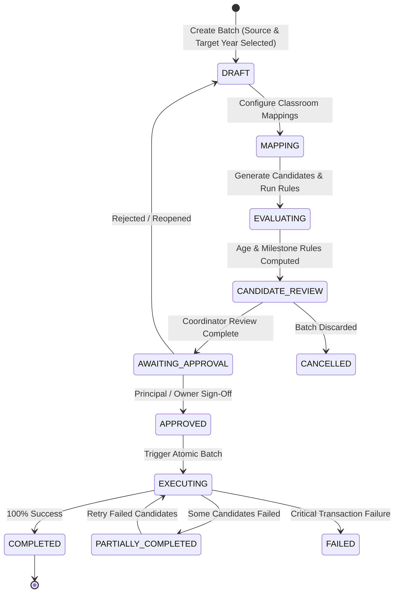
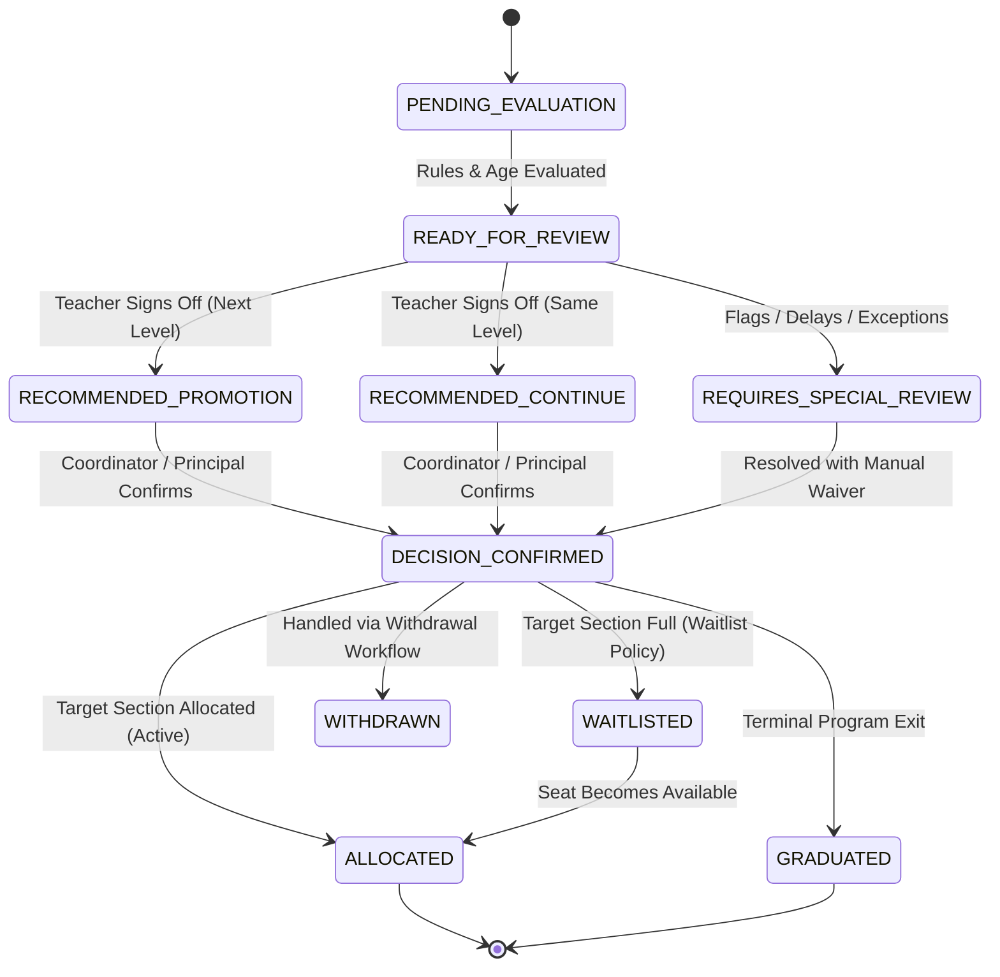

# PreOne Promotion State Machine Specification
**Specification:** `PRE1-STUDENT-LIFECYCLE-001`  
**Domain:** Lifecycle State Transitions  
**Version:** 1.0.0  

---

## 1. Promotion Batch State Machine

A promotion batch coordinates the transition of an entire cohort from one academic session to another:

### Batch State Definitions:
- **`DRAFT`:** Source session, target session, and branch scope selected.
- **`MAPPING`:** Classroom source $\rightarrow$ target mapping configured with capacity quotas.
- **`EVALUATING`:** Decision engine calculates age eligibility, retrieves developmental sign-offs, and verifies outstanding fees.
- **`CANDIDATE_REVIEW`:** School administrators review decisions per student (`PROMOTED`, `CONTINUE_CURRENT_LEVEL`, `SPECIAL_REVIEW`, `GRADUATED`).
- **`AWAITING_APPROVAL`:** Review frozen; submitted to Principal/Owner for final authorization.
- **`APPROVED`:** Authorized for execution.
- **`EXECUTING`:** Processing individual student allocations in serialized chunks.
- **`COMPLETED`:** All valid candidates successfully transitioned with audit events.
- **`PARTIALLY_COMPLETED`:** Some candidates failed (e.g., target section reached capacity during concurrent update); safe retry enabled for failed items.

---

## 2. Individual Candidate State Machine

Each student evaluated in the promotion cycle transitions through granular sub-states:

---

## 3. Separation of Non-Promotion Lifecycles

1. **Withdrawal Workflow:**
   - Handled separately via `StudentService.withdrawStudent`.
   - Requires non-destructive exit protocol: settling outstanding invoices, refunding caution deposits, updating status to `INACTIVE` or `ARCHIVED`.
2. **Campus Transfer Workflow:**
   - Handled separately via `StudentService.transferBranch`.
   - Involves inter-branch handoff, moving allocations from Branch $A$ to Branch $B$ with destination branch coordinator acceptance.
3. **Graduation Workflow:**
   - Specialized terminal transition for Sr. KG / UKG students.
   - Status transitions to `GRADUATED`. Certificate generation unlocked.
